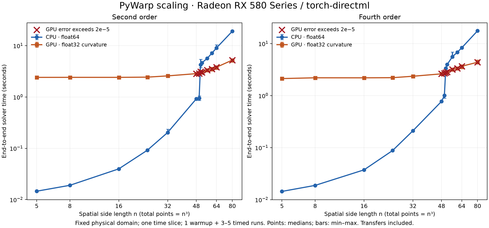

# CPU/GPU scaling on the RX 580

Measured on 24 September 2026 with an AMD Ryzen 5 3600, 16 GiB installed RAM and an 8 GiB Radeon RX 580 using DirectML. These measurements use the optimized contraction-cache solver.

**The observed speed crossover is between 50³ and 51³ spatial points for both orders.** At 50³ (125,000 points), CPU wins; at 51³ (132,651 points), GPU wins. At 64³ the GPU is about 2.3× faster, and at 80³ about 3.6–4.0× faster.

**Accuracy changes the conclusion:** no measured GPU speed win also passed the benchmark's strict 2e-5 normalized-error check. CPU uses float64, while DirectML curvature uses float32. The timings compare the public CPU/device paths, not equal-precision arithmetic.



## Median end-to-end times

All times are seconds. Each case has one full solver warmup; the coarse sweep uses three timed runs and the 50–60³ refinement uses five. All five CPU timings at 51³ were slower than all five GPU timings for the same order.

| Spatial grid | Points | CPU second | GPU second | CPU fourth | GPU fourth |
| --- | ---: | ---: | ---: | ---: | ---: |
| 5³ | 125 | 0.015 | 2.408 | 0.014 | 2.124 |
| 8³ | 512 | 0.019 | 2.411 | 0.019 | 2.199 |
| 16³ | 4,096 | 0.040 | 2.410 | 0.037 | 2.196 |
| 24³ | 13,824 | 0.092 | 2.434 | 0.088 | 2.210 |
| 32³ | 32,768 | 0.203 | 2.575 | 0.211 | 2.355 |
| 48³ | 110,592 | 0.916 | 2.847 | 0.773 | 2.619 |
| 50³ | 125,000 | 0.943 | 2.859 | 1.001 | 2.689 |
| 51³ | 132,651 | 4.237 | 3.114 | 3.339 | 2.772 |
| 52³ | 140,608 | 4.618 | 3.003 | 3.956 | 2.864 |
| 56³ | 175,616 | 5.631 | 3.339 | 5.571 | 3.179 |
| 60³ | 216,000 | 7.162 | 3.514 | 6.799 | 3.354 |
| 64³ | 262,144 | 9.054 | 3.805 | 8.306 | 3.668 |
| 80³ | 512,000 | 19.057 | 5.225 | 17.566 | 4.371 |

## How runtime scales

- Small GPU cases have an approximately 2.1–2.4 second overhead floor. CPU is much faster there.
- CPU time jumps sharply between 50³ and 51³ in this environment. The timings establish the jump; they do not isolate whether allocation, caching or another runtime mechanism causes it.
- Above that jump, larger arrays dominate CPU cost. From 64³ to 80³, the point count grows 1.953×; CPU time grows 2.10× (second) and 2.11× (fourth).
- Over the same interval, GPU time grows only 1.37× (second) and 1.19× (fourth), as its fixed overhead is spread over more points. This does not establish an asymptotic GPU scaling exponent.
- The solver stores and processes a fixed number of arrays per grid point, so nominal arithmetic work and memory are proportional to N. Doubling all three spatial dimensions multiplies N by eight; actual runtime also depends on overhead, memory and allocation behavior.

## Accuracy and memory limits

The normalized error is `max(abs(GPU - CPU)) / max(abs(CPU))`, for the discrete energy tensor. Both orders pass the strict 2e-5 benchmark threshold through 32³; all measured sizes from 48³ onward exceed it. At 51³, errors are 2.60e-5 (second) and 5.41e-5 (fourth). At 80³ they are 6.82e-5 and 1.31e-4, respectively: approximately 0.0068% and 0.0131%. These are global normalized errors, not componentwise relative error bounds or estimates of physical/discretization accuracy.

At 96³, the second-order worker completed warmup but failed during a timed GPU solve with an insufficient-video-memory error. Therefore 80³ is the largest completed repeated-run case, not a proven hard limit for a single solve. The sweep stopped at that failure; fourth-order 96³ and grids 112³/128³ were not attempted. No native peak VRAM usage was measured.

## Reproduce

```powershell
.\.venv-directml\Scripts\python.exe -m benchmarks.backend_scaling --backend torch-directml --sizes 5 8 16 24 32 48 64 80 96 --output sweep.json
.\.venv-directml\Scripts\python.exe -m benchmarks.backend_scaling --backend torch-directml --sizes 50 51 52 56 60 --repeats 5 --output refinement.json
python -m benchmarks.plot_scaling benchmarks/results/rx580-scaling.json --output docs/assets/rx580-scaling.png
```

The spatial domain spans eight units with one time slice, Alcubierre velocity 0.2, radius 1 and sigma 1. Metric construction and backend initialization are excluded. Timed calls include transfers, synchronization, host conversion and final index contraction. Each grid/order starts in a fresh subprocess. See [GPU benchmark methodology](gpu.md#measuring-the-crossover) and [all samples, environment versions and solver source hashes](../benchmarks/results/rx580-scaling.json).

These results apply to this static workload, current machine conditions, installed NumPy/DirectML versions and solver implementation. They do not establish crossover sizes for CUDA float64, time-dependent grids or the complete analysis pipeline.
